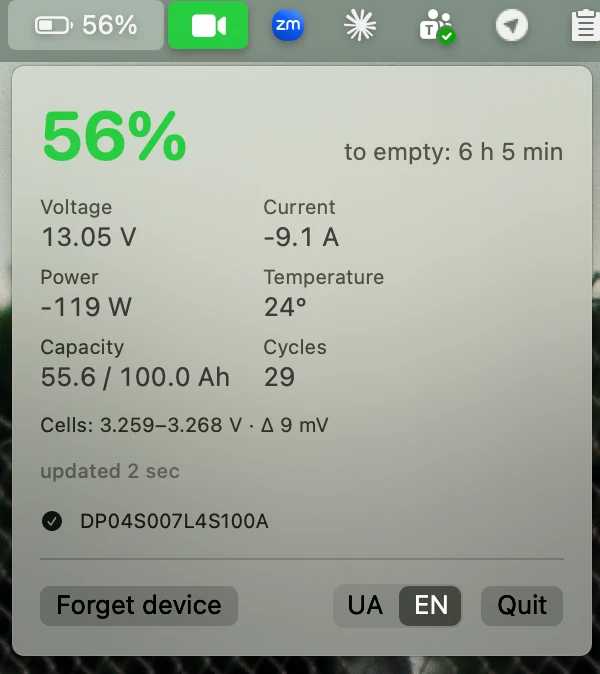
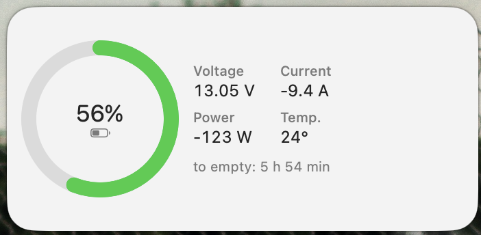
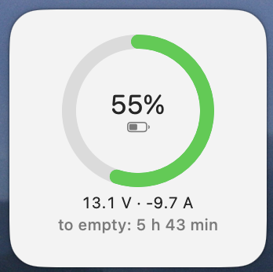
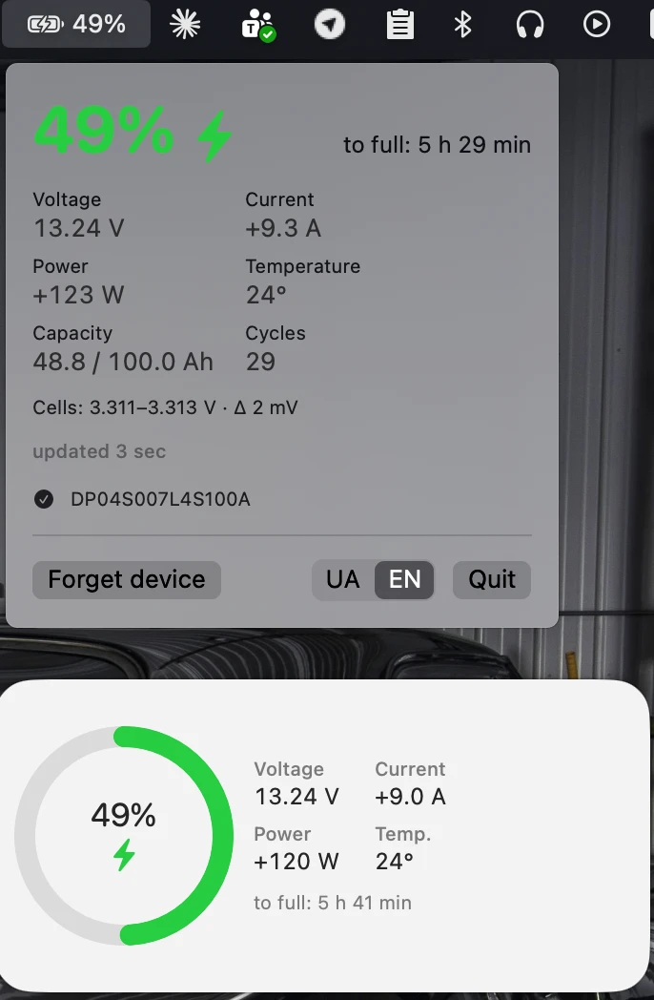

# BMS Widget — JBD / Xiaoxiang → macOS

A menu bar app that reads a JBD BMS (Xiaoxiang Electric) over Bluetooth LE and feeds a WidgetKit desktop widget.
Widgets can't hold a BLE connection themselves, so the app writes `~/Library/Application Support/BMSWidget/snapshot.json` and the widget reads it.

<table>
  <tr>
    <td rowspan="2"></td>
    <td></td>
  </tr>
  <tr>
    <td></td>
  </tr>
</table>

While charging:



## Install

Requires macOS 14+ on Apple Silicon.

> [!IMPORTANT]
> The BMS accepts only one Bluetooth connection at a time. Disconnect your phone first: close the Xiaoxiang app or turn off Bluetooth on the phone, otherwise the Mac can't connect.

1. Download `BMSWidget-<version>.zip` from [Releases](https://github.com/linotex/BMSWidget/releases), unzip it and move `BMSWidget.app` to `/Applications`.
2. The app isn't signed with an Apple certificate, so macOS won't open it until you remove the quarantine flag:
   ```bash
   xattr -cr /Applications/BMSWidget.app
   ```
3. Launch the app, allow Bluetooth and pick your BMS from the menu bar icon.
4. Desktop → Edit Widgets → "Battery".

The UI language (UA / EN) is switched at the bottom of the menu; English is the default.

## Build

No Xcode needed, the Command Line Tools are enough:

1. `tools/build.sh` → `build/BMSWidget.app` (ad-hoc signed; `BUNDLE_PREFIX` and the version come from `project.yml`).
2. Launch `build/BMSWidget.app` (or copy it to `/Applications`) and allow Bluetooth.
3. Pick your BMS from the list in the menu bar icon (it's remembered).
4. Desktop → Edit Widgets → "Battery".

With Xcode: `brew install xcodegen && xcodegen && open BMSWidget.xcodeproj`, then run the **BMSWidget** scheme (set `DEVELOPMENT_TEAM` in `project.yml` for signing).

## Notes

- The widget only stays live while the app is running, so add the app to Login Items.
- The widget refreshes at most about once a minute (WidgetKit limits), the menu every 10 s.
- Protocol: service `FF00` (`FF01` notify / `FF02` write) or `FFE0`/`FFE1`.
  Frames: request `DD A5 03 00 FF FD 77`, response `DD 03 00 <len> … <chk> 77`.
- No App Group: on macOS 15 without a Team ID it asks for access on every launch and the widget doesn't start. Temporary-exception entitlements for a single folder are used instead.

## Checking the parser without a Mac

`python3 tools/verify_jbd.py` is a Python port of `App/JBDProtocol.swift` with tests.
